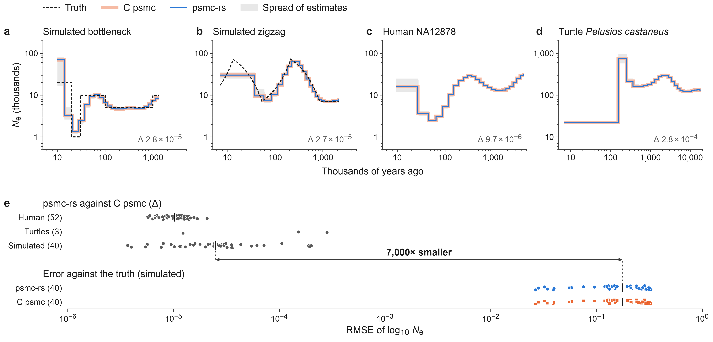
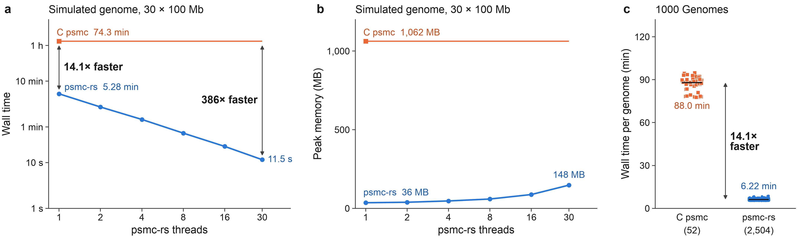
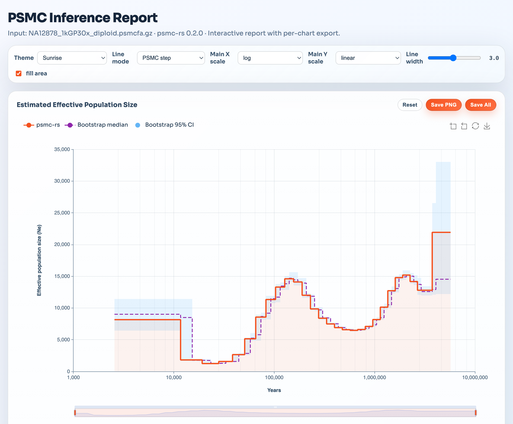
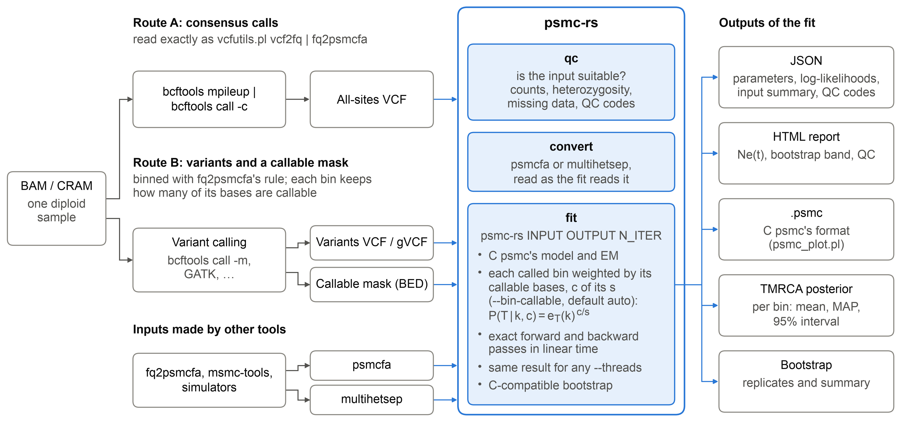

# psmc-rs

psmc-rs infers the history of effective population size from one diploid
genome with PSMC, the pairwise sequentially Markovian coalescent of
[Li and Durbin (2011)](https://doi.org/10.1038/nature10231). It is a Rust
reimplementation of Heng Li's C [`psmc`](https://github.com/lh3/psmc): the
same model, time grid, starting point and `-p` patterns, and the same
curves, in a fraction of the time and memory.



*psmc-rs (blue) drawn over C psmc (orange) on two simulated genomes with
their true history (dashed), a human genome and a turtle genome (**a–d**;
grey, the range of psmc-rs's fits to every replicate of a simulated model,
and psmc-rs's bootstrap 95% band for a real genome; Δ, the RMSE of log10 Ne
between the two programs), and that difference on the 95 genomes both
fitted, next to each program's error against the truth on the simulated
ones (**e**).*

## Why psmc-rs

- **C psmc's results.** On the 95 genomes both programs fitted, the
  population sizes differ by at most 0.15% in any time interval of the
  informative window.
- **Fast and lean.** On a simulated 3 Gb genome, 14 times as fast as C psmc
  on one thread and 386 times on 30; on one thread it needs 36 MB of memory,
  C psmc 1 GB.
- **Reads the data you have.** psmcfa, VCF (also gVCF) and MSMC's
  multihetsep, plain or gzipped. It reads the VCF of `bcftools call -c`
  directly, in place of `vcfutils.pl vcf2fq | fq2psmcfa`, with identical
  bins.
- **Corrects for scattered missing data.** With VCF input, each bin counts
  only its callable bases, which removes most of the bias that missing data
  in short runs cause in C psmc.
- **Everything around the fit.** An input check (`psmc-rs qc`), the
  bootstrap in one command, an interactive HTML report, C psmc's `.psmc`
  output for `psmc_plot.pl`, and per-bin TMRCA posteriors.
- **Deterministic.** The same input and options give the same output, byte
  for byte, on any number of threads.

The evidence, and what the manuscript's experiments measured, is in
[docs/validation.md](docs/validation.md).



*Wall time (**a**) and peak memory (**b**) of 25 EM iterations on a
simulated genome of 30 chromosomes of 100 Mb, each run alone on a node of
KAUST's Ibex cluster (AMD EPYC 7702), medians of five repeats; (**c**) wall
time per genome of the 1000 Genomes fits, each on one core of a shared
node: C psmc on 52 genomes and psmc-rs on all 2,504, in one job.*

## Install

- **Release binaries** for Linux (x86-64, glibc 2.17 or later: CentOS and
  RHEL 7 and newer distributions) and macOS (Intel and Apple silicon) are
  on the [releases page](https://github.com/larryivan/psmc-rs/releases),
  each archive with a `.sha256` checksum (`SHA256SUMS.txt` lists them all:
  `shasum -a 256 -c SHA256SUMS.txt`). On Windows, use the Linux binary
  under WSL.
- **With Cargo** (Rust 1.88 or later): `cargo install psmc-rs --locked`.
- **From source**:

  ```bash
  git clone https://github.com/larryivan/psmc-rs.git
  cd psmc-rs
  cargo install --path . --locked
  ```

Check with `psmc-rs --version`.

## Quick start

Fit a human genome, NA12878 of the 1000 Genomes high-coverage data, as a
psmcfa file of its 22 autosomes (3.4 MB):

```bash
curl -LO https://raw.githubusercontent.com/larryivan/psmc-rs/v0.2.0/experiment/real_data/NA12878_1kGP30x_diploid.psmcfa.gz
psmc-rs NA12878_1kGP30x_diploid.psmcfa.gz fit.json 25
```

The three arguments are the input, the output and the number of EM
iterations (C psmc's `-N`); the fit takes under half a minute on an 8-core
laptop. The run reports on the input (its QC report)
and the model on stderr, and writes:

```text
Last EM loglike: -4817112.848542554
Parameters: fit.json
HTML report: fit.html
```

`fit.json` holds the fitted parameters; open `fit.html` in a browser for
the population size history:



*The report of NA12878 fitted with the human settings below and 20
bootstrap replicates: the fit (orange), the replicates' median (dashed) and
95% band (blue; the report labels it "Bootstrap 95% CI"). Below the chart it lists the run's settings, the fitted
parameters and the QC report; every chart can be restyled and saved as
PNG.*

The run above uses C psmc's defaults (`-t15 -r4 -p "4+5*3+4"`). For modern
humans, the psmc README uses `psmc -N25 -t15 -r5 -p "4+25*2+4+6"`; here
with 100 bootstrap replicates, and C psmc's `.psmc` output as well:

```bash
psmc-rs NA12878_1kGP30x_diploid.psmcfa.gz human.json 25 \
  --pattern '4+25*2+4+6' --tr-ratio 5 \
  --bootstrap 100 --psmc-out human.psmc
```

The replicates run in parallel; each takes about as long as the main fit.
The curve is scaled with a mutation rate of 2.5e-8 per base and generation
and 25 years per generation; set yours with `--mu` and `--gen-years`.

## Your data

| You have | Do this |
| --- | --- |
| Aligned reads (BAM or CRAM) of one sample | `scripts/bam_to_psmc.sh` calls the sites and makes the input ([guide](docs/preprocessing.md#route-a-the-classic-consensus)) |
| An all-sites VCF of `bcftools call -c` | fit it: psmc-rs bins it as `vcf2fq \| fq2psmcfa` would |
| Variant calls (GATK, DeepVariant, `bcftools call -m`) or a gVCF | fit them with a mask of the callable sites, `--vcf-mask callable.bed` ([how to make one](docs/preprocessing.md#the-callable-mask)) |
| A psmcfa file (from `fq2psmcfa`) | fit it; give `--bin-size` the `-s` it was made with (100 by default) |
| An MSMC multihetsep file | fit it (`--mhs-pair` picks the two haplotypes); with missing data, the VCF it came from gives a better fit |



*From aligned reads to an input and the outputs of a fit. Both routes'
VCFs record the callable bases of each bin, which the fit weighs by
default; a psmcfa does not.*

Check any input before fitting it:

```bash
psmc-rs qc calls.vcf.gz
```

The report counts the bins, the heterozygosity and the missing data, per
sequence, and names what to fix: a variants-only VCF without a mask, sex
chromosomes, too little coverage, bins too large for the heterozygosity
([docs/qc.md](docs/qc.md) lists every finding and what to do about it).
Every fit prints the same report.

[docs/preprocessing.md](docs/preprocessing.md) goes from aligned reads to
an input step by step, with the pitfalls: coverage, depth bounds, masks,
sex chromosomes, repeats, the mutation rate and the generation time.

## Coming from C psmc

| C psmc | psmc-rs |
| --- | --- |
| `vcfutils.pl vcf2fq` and `fq2psmcfa -q20` | fit the VCF directly with `--min-qual 20`, or write the psmcfa: `psmc-rs convert calls.vcf.gz --min-qual 20 --psmcfa in.psmcfa` (the depth bounds default to the psmc README's advice; `--depth 3:100000` gives vcf2fq's own default) |
| `psmc -N25 -t15 -r5 -p "4+25*2+4+6" -o out.psmc in.psmcfa` | `psmc-rs in.psmcfa out.json 25 --t-max 15 --tr-ratio 5 --pattern '4+25*2+4+6' --psmc-out out.psmc` |
| `-i old.psmc` | `--init-params old.json` |
| `splitfa` and `psmc -b`, one job per replicate | `--bootstrap 100` |
| `psmc_plot.pl` | `out.html`, or `psmc_plot.pl` on `--psmc-out` |

The `.psmc` output follows C psmc's format, so `psmc_plot.pl` and other
tools read it. psmc-rs fits C psmc's model to psmcfa input and to complete
data; for a VCF whose bins are partly callable it weighs each bin by its
callable bases, which `--bin-callable ignore` turns off.

## Reading the results

**The HTML report** (`fit.html`, next to the JSON) draws the history of the
effective population size, with the bootstrap's median and 95% band when
there are replicates, and lists the run's settings, the fitted parameters
and the QC report. It loads its charting library from cdn.jsdelivr.net;
offline, set `PSMC_ECHARTS_JS` to a local `echarts.min.js` when running
psmc-rs, and the report embeds it.

**psmc_plot.pl.** With `--psmc-out`, the run prints (on stderr, not with
`-q`) the command that plots the file with C psmc's `psmc_plot.pl`:

```bash
psmc_plot.pl -s 100 -u 2.5e-8 -g 25 -n 25 PREFIX fit.psmc
```

Give `-s` the bin size, which a `.psmc` file does not record, and `-n` the
number of iterations, since psmc_plot.pl plots round 20 otherwise. To plot
the bootstrap replicates with the fit, as C psmc users do, concatenate the
files (the run prints this recipe too, when the replicates have as many
iterations as the main fit, the default):

```bash
cat fit.psmc fit.bootstrap/replicate_*.psmc > combined.psmc
psmc_plot.pl -s 100 -u 2.5e-8 -g 25 -n 25 PREFIX combined.psmc
```

**Scaling.** The fitted parameters are per bin and in units of 2N0
generations; `--mu` (2.5e-8 per base and generation) and `--gen-years` (25)
only turn them into individuals and years: N0 = θ / (4 μ s) for bins of s
bases, so halving μ doubles both axes. To rescale without fitting again,
plot the `.psmc` file with other `-u` and `-g`. A known false-negative rate
of heterozygous calls is a correction to μ
([docs/preprocessing.md](docs/preprocessing.md#low-coverage)).

**The ends of the curve.** Each free λ is estimated from the coalescences
in its intervals. The most recent and the most ancient intervals hold few,
so steps at either end of the curve, such as the last one in the report
above, are poorly determined. The run warns when a fitted λ sits on its
upper bound (1e4), where the data hold almost no coalescences
([docs/fitting.md](docs/fitting.md#the-m-step)).

**The bootstrap band is a lower bound on the uncertainty**, not an interval
for the true history: it measures the sampling spread of the fit, not
PSMC's bias. In the manuscript's calibration (experiment E5), the 95% bands
held the true Ne at fewer than half of the times
([docs/validation.md](docs/validation.md#bootstrap-calibration)). A smaller
check of the bootstrap's spread against the true sampling spread,
`examples/bootstrap_calibration.rs`, runs in a few minutes:
`cargo run --release --example bootstrap_calibration -- --threads 4`.

## Commands and options

| command | what it does |
| --- | --- |
| `psmc-rs INPUT OUTPUT N_ITER` | fit PSMC with N_ITER EM iterations ([docs/fitting.md](docs/fitting.md)) |
| `psmc-rs qc INPUT` | check an input without fitting it ([docs/qc.md](docs/qc.md)) |
| `psmc-rs convert INPUT --psmcfa FILE` | write the input, as read, as psmcfa or multihetsep ([docs/inputs.md](docs/inputs.md#writing-inputs-psmc-rs-convert)) |
| `psmc-rs --tui` | the fit in a terminal interface ([docs/tui.md](docs/tui.md)) |

The options a fit most often needs:

| option | default | what it sets |
| --- | --- | --- |
| `--pattern P` | `4+5*3+4` | how the time intervals share free parameters (C `-p`) |
| `--tr-ratio R` | 4 | the starting θ/ρ (C `-r`) |
| `--t-max T` | 15 | the starting maximum time, in 2N0 generations (C `-t`) |
| `--bin-size BP` | 100 | bases per bin (`fq2psmcfa -s`) |
| `--mu MU`, `--gen-years Y` | 2.5e-8, 25 | the scaling to individuals and years |
| `--bootstrap N` | 0 | bootstrap replicates |
| `--psmc-out FILE` | | C psmc's `.psmc` output |
| `--tmrca-out FILE` | | per-bin TMRCA posteriors (TSV) |
| `--vcf-mask BED` | | the callable sites of a VCF (repeatable) |
| `--vcf-sample NAME` | | the sample of a VCF of several |
| `--threads N` | one per core | the worker threads; the results do not depend on it |
| `-q`, `--no-progress` | | less output on stderr, for batch runs |

Every option is in [docs/options.md](docs/options.md) and in
`psmc-rs --help` (`-h` for a summary). The exit status is 0 on success, 1
on an error and 2 on a usage error, and also for `qc --strict` when the
report has a warning ([docs/outputs.md](docs/outputs.md#exit-status)).

## Documentation

| page | what it covers |
| --- | --- |
| [docs/preprocessing.md](docs/preprocessing.md) | from aligned reads to an input, and the pitfalls |
| [docs/inputs.md](docs/inputs.md) | how each format is read; masks; missing data and partly callable bins; `convert` |
| [docs/fitting.md](docs/fitting.md) | the model options, the starting point, the M-step, the bootstrap |
| [docs/outputs.md](docs/outputs.md) | every output file, the console and the exit status |
| [docs/qc.md](docs/qc.md) | the input check, and what to do about each finding |
| [docs/tui.md](docs/tui.md) | the terminal interface |
| [docs/performance.md](docs/performance.md) | threads, memory, determinism and the CPU kernels |
| [docs/validation.md](docs/validation.md) | agreement with C psmc, the tests, the manuscript's experiments |
| [docs/options.md](docs/options.md) | every option |

## Testing

```bash
cargo test
python3 -m unittest discover -s experiment/tests
```

The tests compare psmc-rs with the outputs of C psmc and of the classic
tools, stored under `tests/data/` with the scripts that made them
([docs/validation.md](docs/validation.md#the-tests)).

## Reproducing the manuscript

`experiment/pipeline/` makes the manuscript's experiments, tables and
figures with psmc-rs 0.2.0: it simulates the genomes, runs psmc-rs and C
psmc with matched settings, records how every output was made, and draws
the figures from the tables.
[experiment/pipeline/README.md](experiment/pipeline/README.md) describes
it, and
[Supplementary Note 1](experiment/Supplementary_Note_1_Reproducibility.md)
how to reproduce the results on a laptop or a SLURM cluster. The results
are in `experiment/runs/E1` to `E7` and `FIG`;
[experiment/README.md](experiment/README.md) gives an overview.

## Citing

If you use psmc-rs, please cite it as given in [CITATION.cff](CITATION.cff)
(GitHub's "Cite this repository"; every release is archived on Zenodo,
[doi:10.5281/zenodo.18759759](https://doi.org/10.5281/zenodo.18759759)),
together with the PSMC paper:

> Li H, Durbin R (2011). Inference of human population history from
> individual whole-genome sequences. *Nature* 475:493-496.
> doi:10.1038/nature10231

Its O(states) forward and backward steps, and its sums of the expected
transition counts, use the rank-one triangles of the transition matrix, as
in:

> Harris K, Sheehan S, Kamm JA, Song YS (2014). Decoding coalescent hidden
> Markov models in linear time. In *Research in Computational Molecular
> Biology (RECOMB 2014)*, LNCS 8394:100-114.

## Contributing and license

Bug reports and pull requests are welcome; see
[CONTRIBUTING.md](CONTRIBUTING.md). psmc-rs is released under the MIT
license ([LICENSE](LICENSE)). The C psmc outputs under
`tests/data/c_reference/` come with C psmc's license (`PSMC_LICENSE.txt`
there).
